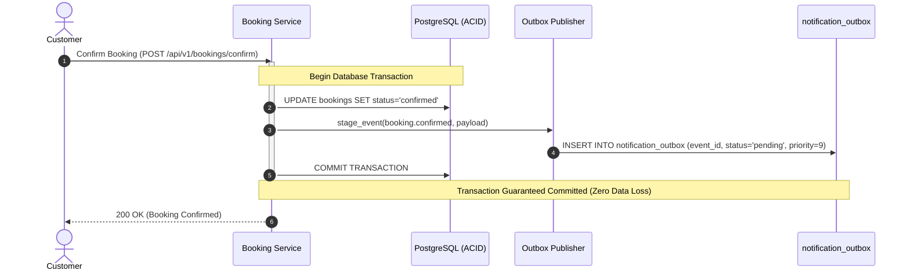
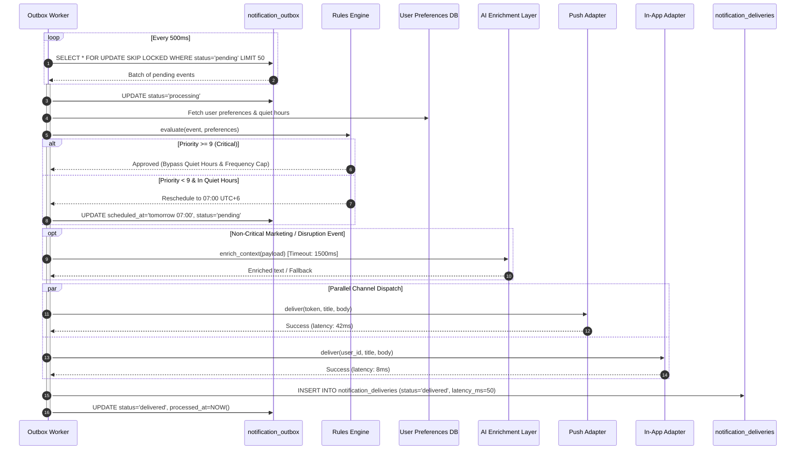
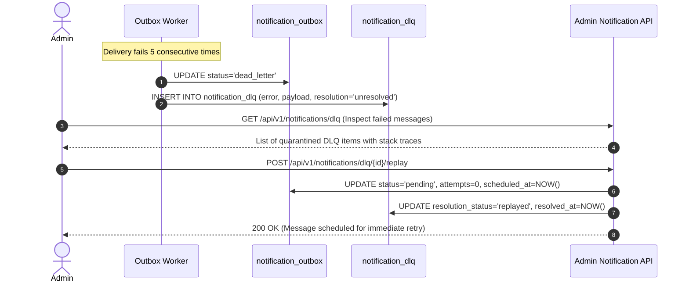

# Notification Platform End-to-End Architecture

**Platform**: ShopnoJatra Event-Driven Notification Intelligence Platform  
**Architecture Style**: Transactional Outbox, Deterministic Rules Engine, 20D Hyper-Personalization Pipeline, Non-Gating AI Enrichment, Pluggable Multi-Channel Delivery  
**Version**: 2.0.0  
**Last Updated**: 2026-11-27

---

## 1. Architectural Philosophy & Core Tenets

1. **Zero Message Loss (Guaranteed At-Least-Once Delivery)**:  
   Critical transactional messages (booking confirmations, payment receipts, OTPs, SOS alerts) are staged atomically in the same ACID transaction as the business entity change via the **Transactional Outbox Pattern**. Network hiccups or Celery worker crashes never cause lost customer notifications.

2. **Deterministic Safety Before AI Augmentation (Non-Gating AI)**:  
   Compliance with user quiet hours, channel preferences, frequency caps, and priority bypasses is evaluated deterministically by the **Rules Engine**. AI services (Google Gemini) provide non-gating enrichment (tone refinement, smart timing, context summarization); if AI fails or times out (> 1500ms), standard templates are delivered with zero delay.

3. **Pluggable Multi-Channel Dispatch with Zero-Credential Mocking**:  
   Delivery adapters for Push (Expo/FCM), In-App (WebSockets & Supabase Realtime), Email (SMTP), and SMS (Gateway) adhere to uniform interfaces (`BaseDeliveryAdapter`). In development and testing environments, mock drivers simulate dispatches in-memory without requiring live third-party credentials or Redis.

4. **Idempotency & Dead-Letter Quarantine**:  
   Every outbox entry contains a deterministic idempotency key. Messages exceeding maximum retry thresholds ($N=5$) are quarantined into a dedicated `notification_dlq` table for administrative diagnosis and replay.

---

## 2. High-Level System Architecture

```
┌────────────────────────────────────────────────────────────────────────────────────────┐
│                                APPLICATION DOMAIN SERVICES                             │
│       [BookingService]       [PaymentService]       [PriceAlertTask]      [KYCService] │
└──────────────────────────────────────────┬─────────────────────────────────────────────┘
                                           │
                                           ▼ (Atomic DB Session)
┌────────────────────────────────────────────────────────────────────────────────────────┐
│                             TRANSACTIONAL OUTBOX (DATABASE)                            │
│  INSERT INTO notification_outbox (event_id, event_type, payload, status='pending')     │
│  REPLICA IDENTITY FULL  ──►  Supabase Realtime CDC (Instant Client In-App Feed)        │
└──────────────────────────────────────────┬─────────────────────────────────────────────┘
                                           │
                                           ▼ (Row-Lock: SELECT ... FOR UPDATE SKIP LOCKED)
┌────────────────────────────────────────────────────────────────────────────────────────┐
│                              OUTBOX WORKER POLLING ENGINE                              │
│  - Idempotency & Deduplication Check (TTL window)                                      │
│  - Exponential Backoff & Jitter Calculation                                            │
└──────────────────────────────────────────┬─────────────────────────────────────────────┘
                                           │
                                           ▼
┌────────────────────────────────────────────────────────────────────────────────────────┐
│                               DETERMINISTIC RULES ENGINE                               │
│  - Audience Matching & Category Subscriptions                                          │
│  - Quiet Hours Evaluation (22:00 - 07:00 local time)                                   │
│  - Priority Tier Evaluation (P0/P1 Bypass vs P2/P3 Reschedule)                         │
│  - Frequency Capping (Max 3 marketing/day)                                             │
└─────────────────────┬────────────────────────────────────┬─────────────────────────────┘
                      │ (Suppressed / Postponed)           │ (Approved for Dispatch)
                      ▼                                    ▼
           [Scheduled for Next Window]      ┌─────────────────────────────┐
                                            │    AI ENRICHMENT LAYER      │
                                            │ (Smart Timing / Tone / Sum) │
                                            │ Circuit Breaker: 1500ms TTL │
                                            └──────────────┬──────────────┘
                                                           │ (Enriched or Fallback)
                                                           ▼
┌────────────────────────────────────────────────────────────────────────────────────────┐
│                              PLUGGABLE DELIVERY ADAPTERS                               │
│  ├── PushAdapter      (Expo Push / FCM / Mock)                                         │
│  ├── InAppAdapter     (Postgres notifications table + WebSockets + Realtime)           │
│  ├── EmailAdapter     (SMTP / HTML Jinja / Mock)                                       │
│  └── SmsAdapter       (SMS Gateway / Mock)                                             │
└─────────────────────┬────────────────────────────────────┬─────────────────────────────┘
                      │ (Success)                          │ (Max Retries Exceeded)
                      ▼                                    ▼
       [notification_deliveries]                  [notification_dlq]
       (Delivery Telemetry & Latency)             (Quarantine & Admin Replay)
```

---

## 3. Component Deep Dive & Boundaries

### 3.1 Transactional Outbox Publisher (`backend/app/notifications/outbox/publisher.py`)
- **Responsibility**: Atomically stages domain events into `public.notification_outbox` inside the existing SQLAlchemy `AsyncSession`.
- **Interface Contract**:
  - `OutboxPublisher.publish_idempotent(db, event, idempotency_key=None, scheduled_at=None) -> Tuple[NotificationOutbox, bool]` (deterministic UUIDv5 `event_id` deduplication both in-session and against committed DB rows)
  - `OutboxPublisher.publish(db, event, scheduled_at=None, idempotency_key=None) -> NotificationOutbox`
  - `OutboxPublisher.publish_batch(db, events, scheduled_at=None) -> List[NotificationOutbox]`
- **Concurrency & Locking**: In PostgreSQL, the polling worker (`OutboxWorkerProcessor`) claims rows via `SELECT ... FOR UPDATE SKIP LOCKED`. SQLAlchemy models in `backend/app/models/notification.py` and `personalization.py` use `JSON().with_variant(ARRAY(Text), "postgresql")` and `JSON().with_variant(JSONB, "postgresql")` for full PostgreSQL production and SQLite test parity.

### 3.2 Deterministic Rules Engine (`backend/app/notifications/rules/engine.py`)
- **Evaluation Order**:
  1. **Preference Check**: Checks if the target user has disabled the designated channel (`email_enabled`, `push_enabled`, etc.) or the category (`category_marketing`, `category_flight_alerts`).
  2. **Priority Evaluation**: If `priority >= 9` (P0/Critical: SOS, OTP, booking confirmation), immediately bypass quiet hours and frequency caps.
  3. **Quiet Hours Check**: If user has `quiet_hours_enabled` and local time is between `quiet_hours_start` and `quiet_hours_end`:
     - If event allows rescheduling: Set `scheduled_at` to the user's quiet hours end time.
     - If event is promotional: Suppress dispatch.
  4. **Frequency Capping**: If category is marketing and user has received $\ge 3$ marketing notifications today, suppress message.
- **Contract**:
  ```python
  class RulesEngine:
      async def evaluate(
          self, 
          event: DomainEvent, 
          user_preferences: Optional[NotificationPreference]
      ) -> RuleEvaluationResult:
          # returns matched_channels, is_suppressed, suppression_reason, scheduled_at
          ...
  ```

### 3.3 AI Notification Intelligence Layer (`backend/app/notifications/ai/service.py`)
- **Role**: Non-blocking enrichment service using Google Gemini (`gemini-2.5-flash`).
- **Features**:
  - Context summarization: Generates concise 2-sentence summaries of flight delays or travel itineraries in English or Bengali.
  - Smart timing: Recommends optimal delivery time windows based on user engagement history.
  - Sentiment/tone adaptation: Adjusts customer service messaging tone during disruptions.
- **Circuit Breaker & Fallback**:
  - Hard timeout enforced via `asyncio.wait_for(..., timeout=1.5)`.
  - If AI model throws an exception, times out, or circuit breaker trips after 5 consecutive failures, the pipeline immediately falls back to static Jinja2/SQL templates. **Critical transactional messages never touch the AI layer.**

### 3.4 Pluggable Multi-Channel Delivery Adapters (`backend/app/notifications/delivery/`)
- **Abstract Base Adapter**:
  ```python
  class BaseDeliveryAdapter(ABC):
      @abstractmethod
      async def deliver(
          self, 
          recipient: str, 
          title: str, 
          body: str, 
          data: Dict[str, Any], 
          **kwargs
      ) -> DeliveryResult:
          ...
      @abstractmethod
      def is_healthy(self) -> bool:
          ...
  ```
- **Implementations**:
  - `PushDeliveryAdapter`: Formats payloads for Expo Push API (`https://exp.host/--/api/v2/push/send`) with `is_valid_push_token` validation and automatic stale-device deactivation on `INVALID_PUSH_TOKEN` / `DeviceNotRegistered` / `UNREGISTERED` / `MismatchSenderId`. Defaults to `mock_expo` (`[DEV MOCK]`) in dev/test or when `EXPO_ACCESS_TOKEN` is unset.
  - `InAppDeliveryAdapter`: Persists row into `public.notifications` and broadcasts payload over FastAPI WebSockets (`ws_manager.broadcast_to_channel(...)`), paired with Postgres Realtime CDC.
  - `EmailDeliveryAdapter`: Renders XSS-escaped HTML via `render_safe_email_html` (`html.escape` + safe scheme href filtering) and dispatches via `smtplib.SMTP` offloaded with `asyncio.to_thread(...)`. Defaults to `mock_smtp` when `SMTP_PASSWORD` is unset or placeholder.
  - `SmsDeliveryAdapter`: Normalizes phone numbers to E.164 (`normalize_phone_e164` supporting Bangladesh `+880` local formats) and posts asynchronously via `httpx.AsyncClient` to `SMS_GATEWAY_URL`. Defaults to `mock_sms_gateway` when `SMS_GATEWAY_API_KEY` is unset or placeholder.

### 3.5 Worker Queue, Retry Policy & Dead-Letter Queue (DLQ)
- **Retry Policy**:
  - Max attempts: 5.
  - Exponential backoff with decorrelated jitter:
    $$T_{\text{next}} = \text{now} + \min(2^{\text{attempts}} \times 5, 3600) + \text{random}(0, 5)$$
- **Quarantine**:
  - Upon reaching `max_attempts`, status transitions to `dead_letter`.
  - A copy of the payload, failure reason, and stack trace is recorded in `public.notification_dlq`.
  - An administrative event `system.dlq.message_quarantined` is emitted.
- **Replay**:
  - Admins trigger replay via `/api/v1/notifications/admin/dlq/{id}/replay` (or discard via `/admin/dlq/{id}/discard`), resetting outbox attempts to 0 and status to `pending`.

---

## 4. End-to-End Sequence Diagrams

### 4.1 Transactional Outbox Write Path



### 4.2 Outbox Polling, Rules Evaluation & Multi-Channel Delivery



### 4.3 DLQ Quarantine & Administrative Replay



---

## 5. Client Real-Time Integration & Supabase CDC

```
[Postgres Database]
         │
         ▼ (Logical Replication)
[Supabase Realtime CDC]
         │
         ▼ (WebSocket Stream: channel='notifications:{user_id}')
[src/services/events/supabaseRealtimeBridge.ts]
         │
         ├───► Update Zustand Store (`src/store/notificationStore.ts`)
         │         │
         │         ▼
         │   [NotificationBellDropdown.tsx] (Unread badge increment + toast)
         │         │
         │         ▼
         └───► [NotificationsInboxScreen.tsx] (Live list prepending)
```

---

## 6. Administrative Command Center Architecture

`src/screens/admin/NotificationCenterScreen.tsx` exposes **16 workspace tabs** backed by `src/services/notificationCommandService.ts` and `src/services/personalizationService.ts`:

- **3 Inline Workspace Workflows**:
  1. `compose` (*Dispatch Campaign*): Multi-channel broadcast composer, audience/segment targeting, audience dry-run preview, deep-link validation (`notificationDeepLinkRegistry.ts`), and timezone-aware campaign scheduling.
  2. `scheduled` (*Scheduled Queue*): Scheduled/paused/running campaign lifecycle management.
  3. `history` (*Broadcast History*): Past broadcast & campaign execution audit history.
- **13 Dedicated Modules in `src/screens/admin/notifications/`**:
  1. `PersonalizationOverviewTab.tsx` (*AI Overview*)
  2. `LiveOpsTab.tsx` (*Live Ops* outbox/worker feed)
  3. `EventCatalogTab.tsx` (*Event Catalog* inspector & dry-run)
  4. `TemplateManagerTab.tsx` (*Templates (EN/BN)* & variable preview)
  5. `PersonalizationRulesTab.tsx` (*Rules & Weights* rule config versioning/rollback + notification rules)
  6. `AiPersonalizationLabTab.tsx` (*AI Preview Lab* & A/B experiments)
  7. `SegmentBuilderTab.tsx` (*Segments* 14 built-in + custom audience segments)
  8. `DeliveryLogsTab.tsx` (*Delivery Logs* masked recipient audit explorer)
  9. `DlqAndOpsTab.tsx` (*Outbox & DLQ* inspect/replay/discard)
  10. `PerformanceAnalyticsTab.tsx` (*Analytics & A/B* funnel & channel metrics)
  11. `ProviderHealthTab.tsx` (*Provider Health* adapter & circuit health)
  12. `ProfileExplorerTab.tsx` (*20D Profiles* behavioral profile inspector)
  13. `FatigueMonitoringTab.tsx` (*Fatigue & Caps* 5-tier fatigue controls)

---

## 7. v2 Hyper-Personalization, Scheduled Automations & PostgreSQL Security

- **20D Decision Pipeline (`backend/app/notifications/personalization/`)**: 14 modular services (see `PERSONALIZATION_ARCHITECTURE.md`) persisted across 12 tables from `20260622_hyper_personalized_notification_intelligence.sql`, backed by seeded `v1` rule weights and 14 built-in segments.
- **Scheduled Celery Beat Automations (`backend/app/tasks/travel_automation_tasks.py`, `kyc_tasks.py`, `ledger_tasks.py`, `price_alert_tasks.py`)**: Idempotent periodic scans for trip preparation (7d/3d/1d), hotel check-in/check-out reminders, incomplete booking recovery with cooldown/suppression, disruption/refund reconciliation, KYC expiry warnings, price alerts, and ledger imbalance alerts.
- **Zero-Trust PostgreSQL RLS & RBAC (`20260621`, `20260622000000`, `20260622_hyper`)**:
  - `ENABLE` + `FORCE ROW LEVEL SECURITY` across all 22 notification and personalization tables.
  - Subquery-cached `(SELECT auth.uid())` and `(SELECT public.is_admin())` predicates with zero `multiple_permissive_policies` across 24 audited tables.
  - Caller-role anti-enumeration guards inside `public.is_admin()`, `public.get_admin_role()`, and `public.has_admin_permission()` supporting both `admin_role` ENUM and `TEXT` schemas.
